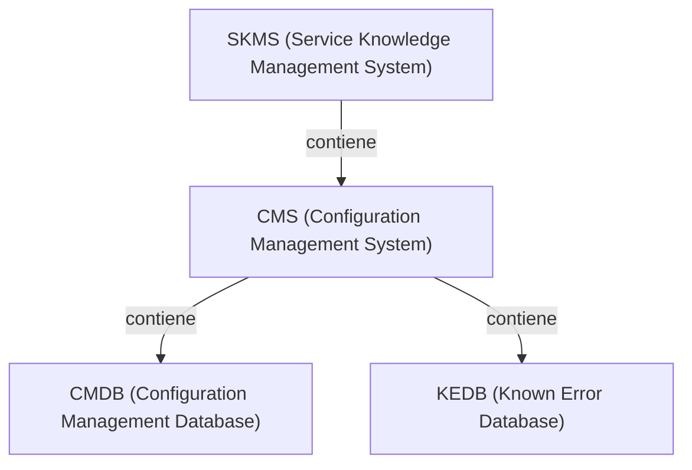
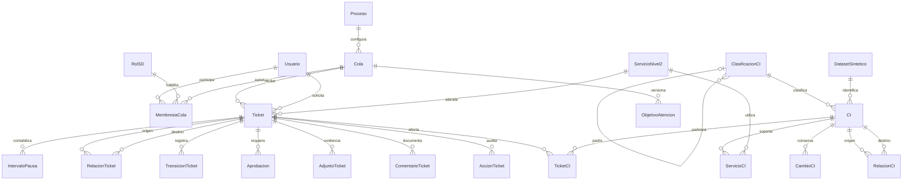
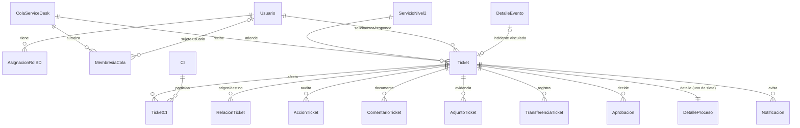

# Modelo de Service Desk y transcripción CMDB

Fecha: 2026-10-29. **V6: CMDB integrada y núcleo SD implementado (sección
final); conocimiento, indicadores y generación siguen propuestos.** El esquema
implementado del parcial se conserva en [MODELO_DATOS](MODELO_DATOS.md).
Requisitos: [SERVICE_DESK](SERVICE_DESK.md); fuentes: [inventario](FUENTES_SERVICE_DESK.md).

## Transcripción de la jerarquía realmente observable

L22 diapositiva 14, diagrama derecho: SKMS contiene CMS; CMS contiene CMDB y
KEDB. L22-12/23 explica que CMS integra información de CI y que forma parte de
SKMS. Esta es **contención de sistemas de información**, no clasificación de
dispositivos; no asignar un CI a SKMS o KEDB como categoría física.

| Elemento transcrito | Origen | Relación observable / límite |
|---|---|---|
| SKMS | L22-14/23 | Sistema de conocimiento; contiene CMS. |
| CMS | L22-12/14/23 | Sistema de configuración; integra CMDB y KEDB según dibujo. |
| CMDB | L22-11/14 | Base de información de CI. |
| KEDB | L22-14 | Base de errores conocidos. No es una clase de dispositivo. |
| Hardware / Software | `CMDB!C5:C6` | Dos tipos de CI de ejemplo; no se establece un padre. |
| Padres/Hijos | `CMDB!J4:J6` | Campo presente; ejemplos vacíos tras tratar el espacio como ausencia. |
| Seis dominios alrededor de CMDB | L22-11, imagen inferior derecha | Inventarios hardware/software/red, datos de usuario/administrativos y contratos; no aristas jerárquicas entre clases. |

**SD-DP01:** no se dispone de una taxonomía original enumerada por niveles.
El modelo genérico siguiente puede soportarla, pero no define ni puebla sus
nodos. No sustituirla por Empresa→Área→Departamento→Sección→Puesto→Usuario,
que sigue siendo una jerarquía organizacional independiente. La correspondencia
requerida por SD-P04 permanece pendiente, aunque el diagrama observable ya está
transcrito con localizadores.

## ER propuesto: relaciones principales

Cardinalidades operativas y roles de FK deben concretarse en migraciones futuras.
MembresiaCola admite usuario **o** rol como sujeto (exactamente uno por registro);
un usuario puede recibir roles SD múltiples mediante una relación independiente.
No son relaciones huérfanas opcionales: una membresía siempre tiene sujeto válido.

## Diccionario de entidades nuevas (propuesto)

| Entidad / módulo | Campos y restricciones previstas |
|---|---|
| Ticket / service_desk | PK, número único, título/descripción, solicitante/creador FK Usuario, N2 FK obligatorio; N1 derivado; tipo/subtipo, proceso, cola, responsable, estado, prioridad, impacto, urgencia, canal, creación/actualización/resolución/cierre; motivo sin CI; control de versión. Responsable puede estar sin asignar mientras espera en cola, política por cerrar. |
| Cola / service_desk | Código único, nombre, descripción, estado, proceso único obligatorio, responsables, nivel de soporte, orden y objetivos versionados. Cola.proceso coherente con Ticket.proceso. |
| RolSD, RolUsuario, MembresiaCola / accounts y service_desk | Capacidades por sujeto/cola; consultar, atender, transferir, aprobar y administrar separadas. Usuario global CONSULTA bloquea escritura aun con membresía. |
| AccionTicket / service_desk | Ticket, actor, fecha, operación, antes/después, motivo, contexto; anexable e inmutable por dominio. Los adjuntos se auditan por metadatos, sin contraseñas/secretos. |
| ComentarioTicket, AdjuntoTicket / service_desk | Visibilidad pública/interna; autor, fecha, referencia privada, tamaño/tipo validado; descarga autenticada por ámbito. |
| Proceso, TransicionTicket / processes | Código de uno de los siete procesos, estados permitidos, origen/destino, actor, permiso, condiciones y evidencia. Configuración no implica motor libre ejecutable por texto externo. |
| Datos de proceso / processes | Nuevos servicios: necesidad/viabilidad/N2 creado; cambios: riesgo/impacto/planes; incidentes: I/duración/redundancia/solución; eventos: E/clave idempotente/incidente; problemas: causa/soluciones/error; accesos: beneficiario/recurso/permiso/acción; servicio existente: cumplimiento/confirmación. Tablas o formularios específicos por definir. |
| Aprobacion / processes | Ticket, etapa, decisión, aprobador, fecha, motivo y versión del contenido aprobado. Rechazar autoaprobación de acceso y ejecución de cambios sin aprobación vigente. |
| RelacionTicket, TicketCI / service_desk | Relaciones tipadas entre tickets y vínculo M:N con CI; unicidad del par/tipo, no autosreferencia sin regla. Un evento no genera otro incidente al reintentarlo. |
| ClasificacionCI / cmdb | Código único, nombre original, padre opcional raíz, estado, procedencia (fuente/diapositiva/celda), nivel derivado; sin ciclos. Nodos definitivos bloqueados por SD-DP01. |
| CI / cmdb | PK, código único, nombre, tipo/clasificación, estado, ubicación y responsable existentes, campos originales CMDB y atributos técnicos por clase; indicador documentado de dispositivo; IP opcional. Distinguir CI software de dispositivo contable. |
| TipoRelacionCI, RelacionCI, ServicioCI / cmdb | Relación dirigida y tipada con política de ciclos; extremos válidos, sin duplicados. ServicioCI une CI con N2 existente. Clasificación no se mezcla con dependencia técnica. |
| CambioCI, OrigenCMDB / cmdb/imports | Historia y procedencia: hoja/fila/celdas, valor original/normalizado, regla/observación; no forzar RegistroOrigen del catálogo, cuyo enum solo admite N1/N2/opciones. |
| DatasetSintetico / cmdb | Identificador de conjunto, semilla, versión del generador, parámetros y reporte; clave única conjunto+ordinal para repetir sin duplicar. |
| ArticuloConocimiento / knowledge | Título/contenido, estado/publicación, visibilidad, autor y relación con servicio/soluciones. |
| Notificacion / service_desk | Destino autorizado, evento/incidente relacionado, fecha, contenido y estado; prueba interna sin correo real. |
| ObjetivoAtencion, IntervaloPausa / reporting/service_desk | Versión del objetivo de cola, primera atención/resolución y calendario; intervalos válidos y no solapados, motivo/actor. Datos fuente para indicadores. |

## Mapeo completo de CMDB.xlsx

Hoja `CMDB`; encabezados fila 4; ejemplos filas 5–6. Las etiquetas se transcriben
sin atribuirles campos ausentes. Todos los destinos de esta tabla son **previstos**.

| Origen | Etiqueta original | Destino / transformación prevista |
|---|---|---|
| B4:B6 | Nombre del CI | CI.nombre; conservar valor original. |
| C4:C6 | ` Tipo de CI` | Tipo/clasificación de CI; espacio inicial se registra antes de normalizar. Hardware/Software observados, no lista completa inventada. |
| D4:D6 | Descripción | CI.descripcion opcional. |
| E4:E6 | Número de Serie | CI.numero_serie opcional; E6 espacio → ausencia con trazabilidad. |
| F4:F6 | Versión | CI.version opcional, texto; no convertir v1.0 en número. |
| G4:G6 | Fecha de Adquisición | Fecha ISO textual → fecha tipada si válida; conservar original. |
| H4:H6 | ` Estado Actual` | CI.estado_original y catálogo/mapeo explícito; Activo observado. |
| I4:I6 | ` Relaciones` | Referencias textuales, `Base de Datos1` sin CI fuente; observar referencia no resuelta, sin crear aristas falsas. |
| J4:J6 | ` Padres/Hijos` | Relación por aclarar; espacios → ausencia, no propagar ni inventar taxonomía. |
| K4:K6 | Ubicación Física | Texto de ubicación original; `Servidor1` en K6 puede indicar alojamiento. No convertirlo silenciosamente en FK técnica. |
| L4:L6 | ` Propietario/Responsable` | Etiquetas Equipo de Infraestructura/Desarrollo preservadas; vinculación a usuarios/equipos existentes mediante mapeo, sin adivinar identidad. |
| M4:M6 | ` Fecha de Cambio` | Fecha tipada en CambioCI con origen; no reemplazar por fecha de importación. |
| N4:N6 | Descripción del Cambio | Texto en CambioCI. |
| O4:O6 | Documentación relacionada | Texto/enlace original; destino `url` no es URL verificable ni se visita. |
| P4:P6 | ` Enlaces a Incidentes y Problemas` | Referencia textual original; vincular ticket solo cuando exista y se verifique. |
| Q4:Q6 | ` Niveles de Seguridad` | Valor original, Alto/Medio observados; opciones controladas ampliables, sin atribuir lista exhaustiva. |
| R4:R6 | ` Cumplimiento` | Texto original, Cumple observado. |
| S4:S6 | ` Estado de Configuraci√≥n` | Mapeo de encabezado propuesto a estado_configuracion; Aprobado observado; guardar etiqueta dañada original y regla. |
| T4:T6 | ` N√∫mero de Licencia` | Mapeo de encabezado a numero_licencia; texto original preservado. |
| U4:U6 | ` Fecha de Vencimiento` | Fecha tipada opcional; conservar fechas de ejemplo sin actualizarlas artificialmente. |

La inspección de metadatos encontró cero listas de validación de datos y cero
fórmulas en CMDB.xlsx; los valores observados no definen un catálogo completo.
Los campos operativos ID, código único, clasificación, bandera dispositivo,
responsable FK, dataset/semilla, auditoría y fechas de sistema son **adiciones**
de T o del proyecto, no columnas del Excel. Nunca inventar IP obligatoria.

## Generación prevista: al menos 5,000 dispositivos

Validar primero clasificación resuelta, ubicaciones, responsables y N2 existentes.
Semilla configurable + versión + conjunto identifican el dataset; cada ordinal
produce código estable y atributos acordes a su clase. Repetición: actualizar
solo el mismo conjunto según política documentada, sin duplicar ni pisar cambios
humanos silenciosamente. Reportar creados/actualizados/omitidos/observados,
dispositivos únicos y distribución por nivel/categoría; excluir CI software,
relaciones, catálogos y tickets del total de dispositivos.

Datos totalmente sintéticos, sin personas reales. El arranque normal nunca
borra ni regenera. La carga debe fallar con mensaje si faltan referencias o la
taxonomía autorizada. Las guardas actuales prohíben `bulk_create/update` y usan
lock global: no omitirlas con SQL para ganar velocidad. SD-DP09 exige resolver
la estrategia validada y medirla durante implementación, con pruebas aisladas.

## Graph Engineering previsto

| Grafo | Nodos/aristas y reglas | Recorrido/evidencia futura |
|---|---|---|
| G1 clasificación (propuesta para el primer grafo) | Nodo ClasificacionCI; padre→hijo; raíces explícitas; rechazo de autopadre/ciclos/huérfanos; nombres originales al resolver SD-DP01 | Ruta raíz→categoría de cada CI, conteos por nivel y prueba SD-P04. |
| G2 dependencias técnicas (propuesta para el segundo) | CI consumidor→CI proveedor en depende_de/alojado_en; sin ciclos en esos tipos propuestos; conectado_a admite ciclos y es simétrico, sin duplicar la pareja | Desde CI afectado recorrer dependientes en dirección inversa y enlaces ServicioCI; mostrar camino y servicio potencial, nunca asegurar interrupción real. SD-P14. |

Tipos y semántica son decisiones propuestas, no rótulos todos presentes en CM.
Un conjunto visitado evita bucles; alcance/profundidad y permisos limitan cada
recorrido. La vista navega por vecindarios paginados, no dibuja 5,000 nodos de
golpe. Se propone almacenar nodos/aristas en PostgreSQL con FK, sin exigir otro
motor. Grafo de flujos de trabajo adicional en PROCESOS; confirmar con docente
la expresión «ambos grafos» (SD-DP02). No hay grafo ejecutable implementado.

## CMDB persistente: contrato de la implementación de esta fase

El análisis definitivo por celda/página y la comparación completa están en
[ANALISIS_CMDB](ANALISIS_CMDB.md). Modelo mínimo: Hardware/Software como tipos
observados independientes; ningún nivel inferior inferido. El bosque admite
profundidad variable con nivel derivado (raíz=1, decisión técnica). No se pueblan
categorías en la migración; falta confirmar cualquier taxonomía original más
detallada antes de afirmar fidelidad exhaustiva.

~~~mermaid
erDiagram
    ClasificacionCI o|--o{ ClasificacionCI : padre
    ClasificacionCI ||--o{ CI : clasifica
    UbicacionCI ||--o{ CI : ubica
    Usuario ||--o{ CI : responsable
    CI ||--o{ ServicioCI : vincula
    ServicioNivel2 ||--o{ ServicioCI : servicio
    TipoRelacionCI ||--o{ RelacionCI : tipifica
    CI ||--o{ RelacionCI : origen
    CI ||--o{ RelacionCI : destino
~~~

| Modelo | Campos persistentes / restricciones |
|---|---|
| ClasificacionCI | Código único, nombre, estado, padre PROTECT opcional, orden no negativo, esquema_atributos JSON, es_dispositivo=false por defecto y datos_origen JSON. CHECK contra autopadre y validación de ancestros/ciclos. |
| UbicacionCI | Código único, nombre, estado, observaciones y datos_origen; catálogo plano independiente de organización. |
| CI | Código único, nombre, estado administrativo; clasificación, ubicación y Usuario responsable obligatorios/PROTECT; descripción nullable, atributos y datos_origen JSON; propiedad es_dispositivo derivada de clasificación; M:N servicios mediante ServicioCI. |
| TipoRelacionCI | Código único, nombre, estado, origen JSON; dirigida=true y permite_ciclos=false explícitos/configurables. No cambiar flags una vez tenga relaciones. |
| RelacionCI | FK tipo/origen/destino PROTECT, estado, fecha y observaciones; UNIQUE(tipo,origen,destino), CHECK origen≠destino. No dirigida exige origen.pk menor que destino.pk. |
| ServicioCI | FK CI/N2 PROTECT, estado, fecha y observaciones; UNIQUE(ci,servicio). Usar ServicioCI.save, no eludir dominio con servicios.add/bulk. |

Todos heredan timestamps/revision_manual y guardas de DomainModel. Las nuevas
referencias exigen jerarquía activa; referencias históricas se conservan.
Desactivar un padre/Usuario/CI/servicio con dependencias activas se bloquea por
las mismas guardas existentes, que reconocen las relaciones nuevas. No cambian
los modelos PP2 ni sus migraciones.

Esquema de atributos por clasificación, sin herencia implícita: objeto con claves
snake_case y reglas tipo/obligatorio/opciones. Tipos: texto (hasta 255 caracteres),
texto_largo, entero, numero finito, booleano, fecha ISO e ip. Valores no declarados,
tipos incorrectos y obligatorios ausentes se rechazan; booleanos no son números.
Un cambio de esquema no puede invalidar CI existentes, incluidos históricos.

Ejemplo **de configuración del proyecto**, no taxonomía ni datos insertados:

~~~json
{
  "numero_serie": {"tipo": "texto", "obligatorio": false},
  "ip": {"tipo": "ip", "obligatorio": false}
}
~~~

Una clase de software puede definir version/licencia y omitir ip/serie.
Los originales se preservan en atributos o datos_origen según mapeo; campos
operativos/código/FK/orden/flags/esquema son extensiones de la tarea/proyecto.
No hay política de estado_actual del Excel inventada: el estado administrativo
se distingue del atributo original que puede conservarse.

**Ciclos:** clasificación nunca cíclica. Para relaciones técnicas activas, se
considera conjuntamente el subgrafo de todos los tipos con permite_ciclos=false;
se rechaza una arista que cierre un camino, incluso entre tipos distintos.
No dirigidas se consideran en ambas direcciones para esa validación. Tipos con
permite_ciclos=true se excluyen del subgrafo restrictivo. Ningún tipo admite
autoenlace. Los flags quedan congelados si hay relaciones históricas. Se
recomiendan depende_de/alojado_en dirigidos acíclicos y conectado_a no dirigido
cíclico como decisiones del proyecto, sin poblar tipos por migración.

Esto prepara G1 clasificación y G2 técnico para una fase posterior. La búsqueda
interna para rechazar ciclos no es una API, UI ni recorrido de servicios
afectados. Sin Ticket↔CI, generador, importador CMDB ni dashboard.

Migración: src/cmdb/migrations/0001_initial.py; app registrada en settings.
No tiene RunPython, semillas ni datos masivos. Resultados y limitaciones de
validación reales: [FASE_CMDB](evidencias/FASE_CMDB.md).

## Service Desk implementado (V6)

Migraciones: `accounts.0002_rol_operativo`, `service_desk.0001_initial`,
`processes.0001_initial`/`0002_initial` (la segunda añade FK hacia Ticket).
Aplicadas solo en PostgreSQL efímero ([evidencia](evidencias/FASE_SERVICE_DESK.md)).
Todas las entidades heredan `DomainModel`: `save()` valida con `full_clean`
bajo `domain_transaction`; update/bulk/delete rechazados. Las marcadas
**anexable** heredan `AppendOnlyModel` (no admiten modificación).

| Entidad (app) | Campos y reglas implementadas |
|---|---|
| Usuario (accounts) | `rol` ∈ ADMINISTRADOR, CONSULTA, **OPERATIVO** (CHECK). No se desactiva ni pasa a CONSULTA con tickets abiertos asignados. |
| AsignacionRolSD (service_desk) | Usuario + rol SD (SOLICITANTE, AGENTE, APROBADOR), activo; único por par; no se desactiva si sostiene tickets asignados. |
| ColaServiceDesk (service_desk) | `codigo` único, nombre, descripción, `estado`, `proceso` (uno de siete), `nivel_soporte` 0–4, `regla_ordenamiento`, `objetivo_primera_atencion`, `objetivo_resolucion`. Proceso inmutable con tickets; baja bloqueada con tickets abiertos. |
| MembresiaCola (service_desk) | Cola + exactamente un sujeto (usuario **o** rol, CHECK) + `puede_consultar/atender/transferir/aprobar/administrar`, activo. Únicos parciales cola+usuario y cola+rol. |
| Ticket (service_desk) | `identificador` UUID, `secuencia`/`numero` SD-NNNNNN únicos, título, descripción, solicitante, creador, `servicio` N2 (N1 derivado por propiedad, no almacenado), tipo, subtipo, proceso, cola, responsable, estado, prioridad 1–4, impacto, urgencia, canal, resolución, `created_at`, `updated_at`, `fecha_resolucion`, `fecha_cierre`, `motivo_sin_ci`, `revision_manual`. Tipo/subtipo/proceso coherentes; cola del mismo proceso; estado y transición definidos; aprobación vigente para estados que la exigen; responsable activo, no CONSULTA y con ATENDER; cierre⇔estado final; datos de alta inmutables. |
| TicketCI (anexable) | Ticket + CI activo + actor + observación; único por par. Cero CI exige `motivo_sin_ci` al crear. |
| RelacionTicket (anexable) | Origen, destino, tipo (EVENTO_INCIDENTE, INCIDENTE_PROBLEMA, PROBLEMA_CAMBIO, RELACIONADO), actor, motivo. Sin autorrelación, único por terna, un solo incidente por evento, procesos de extremos validados. |
| AccionTicket (anexable) | Ticket, actor, `created_at`, acción, campo, `valor_anterior`/`valor_nuevo` JSON, motivo. Bitácora sin modificación ni borrado. |
| ComentarioTicket (anexable) | Ticket, autor, texto, visibilidad PUBLICO/INTERNO. |
| AdjuntoTicket (anexable) | UUID, ticket, archivo (almacenamiento privado `SD_ADJUNTOS_DIR`, ruta `<ticket>/<uuid>.<ext>`), nombre original saneado, extensión, MIME, tamaño, SHA-256, `subido_por`, `created_at`, visibilidad. |
| TransferenciaTicket (anexable) | Ticket, cola origen/destino (distintas), responsable anterior/nuevo, actor, motivo obligatorio, `created_at`. |
| Notificacion (anexable) | Evento, incidente, cola destino, mensaje; única por evento+incidente. Aviso interno, sin correo. |
| Aprobacion (processes, anexable) | Ticket, aprobador, decisión, estado origen, motivo (obligatorio si rechaza), huella SHA-256 del contenido. Aprobador ≠ solicitante/creador (y ≠ beneficiario en accesos), activo y no CONSULTA. |
| DetalleNuevoServicio | Necesidad, viabilidad, modo CREAR/VINCULAR, `servicio_resultante`, propuesta (código, nombre, N1, sección, descripción). |
| DetalleCambio | Impacto, riesgo, análisis, plan de pruebas, plan de reversión, fecha planificada, resultado de validación, éxito, evidencia de reversión. CI afectados = TicketCI (incluidos en la huella). |
| DetalleIncidente | Afectación, categoría I0–I6, categoría sugerida (calculada), motivo de categoría, duración estimada/real (no negativas), redundancia, diagnóstico, solución aplicada, nivel de escalamiento 0–4. |
| DetalleEvento | `clave_evento` única e inmutable, fuente, categoría E0–E3, evaluación, respuesta, incidente (no reemplazable). |
| DetalleProblema | Causa raíz, workaround, solución definitiva, justificación sin cambio; error conocido = causa + workaround. |
| DetalleAcceso | Beneficiario, recurso, permiso, acción PROVISION/REVOCACION, evidencia, resultado de validación. |
| DetalleServicioTecnologia | Resultado de validación, detalle de cumplimiento. |

Procesos, permisos y flujos: [PROCESOS](PROCESOS.md#implementación-vigente-v6).
