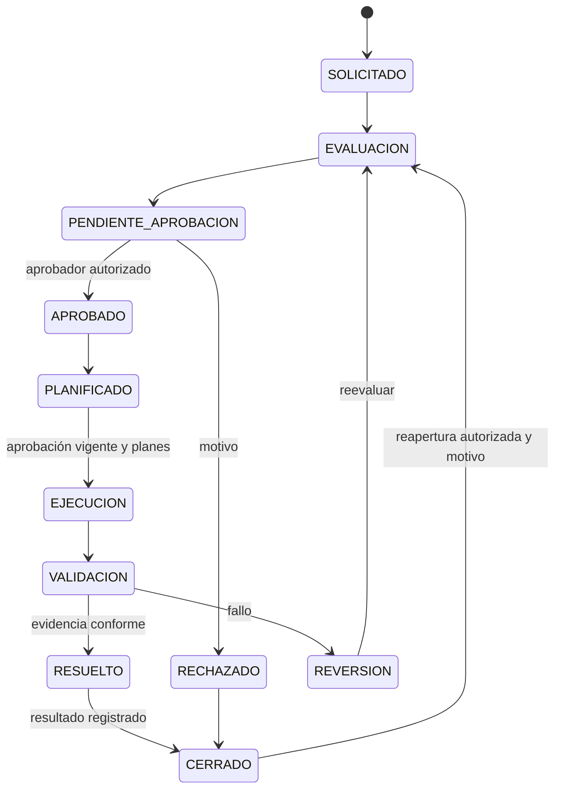

# Procesos, colas y permisos previstos

Fecha: 2026-10-29. **Diseño propuesto, sin funcionalidad implementada.** Fuentes:
T §§4–7/11 y L25-11–16, inventariadas en [FUENTES_SERVICE_DESK](FUENTES_SERVICE_DESK.md).
Estados internos, políticas y umbrales propuestos aquí no son transcripciones
literales de las diapositivas; deberán cerrarse antes de programar.

## Tipos y siete procesos

| Proceso obligatorio | Tipo L25-14 | Subtipo / cola demo propuesta | Datos y distinción |
|---|---|---|---|
| Nuevos servicios | Requisición de servicio | Nuevo servicio / NS | Necesidad, viabilidad y N2 creado o vinculado; no repetir mantenimiento normal. |
| Cambios | Solicitud de cambio | CAM | Riesgo, impacto, CI afectados, aprobación, prueba y reversión. |
| Incidentes | Incidente | INC | Interrupción/degradación, I0–I6, diagnóstico y recuperación. |
| Eventos | Evento | EVT | E0–E3, evaluación, respuesta e incidente vinculado. |
| Problemas | Problema | PRO | Causa raíz, incidentes, error conocido y corrección/cambio. |
| Accesos | Solicitud de acceso | ACC | Beneficiario, recurso, permiso y provisión/revocación. |
| Servicios de tecnología | Requisición de servicio | Servicio existente / ST | Solicitud de cumplimiento sobre un N2 ya existente. |

Cada cola tiene **exactamente un proceso**; un proceso puede tener varias colas.
Las siete demo son un mínimo; no confundir seis tipos con siete procesos ni
con las siete funciones centrales genéricas de L25-4. Los cinco procesos de
transición de L22-9 tampoco sustituyen estos siete flujos de T §6.

## Permisos y alcance propuestos

| Perfil/capacidad | Lectura | Escritura / límites |
|---|---|---|
| Administrador PP2 | Configuración y datos autorizados | Configura colas/roles/objetivos y mantiene base. No obtiene autoaprobación de accesos por ser administrador. |
| Solicitante SD | Propios tickets, comentarios públicos y adjuntos públicos autorizados | Crea solicitudes; aporta comentarios/evidencias y confirma/reabre según política. No lee notas internas ni toma tickets. |
| Agente SD | Colas habilitadas y tickets de ellas | Atender/tomar/asignar solo con capacidad; transferencia es permiso separado. |
| Aprobador SD | Expedientes que puede aprobar | Aprobar/rechazar con capacidad y ámbito; identidad distinta del solicitante en accesos. |
| Consulta PP2 | Datos funcionales de lectura conforme al ámbito | Nunca modificar, atender, transferir, aprobar ni administrar, aun si se le añade una membresía de cola. |

Propuesta de evaluación: autenticado+activo → bloqueo de toda escritura para
CONSULTA → capacidad efectiva → alcance de cola/propiedad → transición/condiciones.
Denegación por defecto. Miembros directos y roles se combinan por unión de
capacidades de lectura/operación permitidas, sin superar el bloqueo CONSULTA.
El alcance de lectura general de CONSULTA sobre tickets sensibles y notas
internas debe definirse explícitamente; no heredar un acceso a todo por el CRUD
del parcial. Notas internas: solo agentes/aprobadores/admin habilitados, nunca
solicitante o CONSULTA por mera lectura funcional.

Roles SD múltiples se proponen como membresías/capacidades aditivas; el campo
actual Usuario.rol y su CHECK no los soportan. Hay que migrar de forma compatible
sin convertir automáticamente las cuentas de consulta en agentes. No se alteró
ese código en esta fase.

## Invariantes comunes de tickets y colas

- N2, solicitante, creador, proceso, tipo y cola válidos; N1 siempre derivado de
  N2. Tipos/procesos coherentes con la tabla. Alta sobre referencias activas,
  manteniendo referencias históricas sin borrarlas después.
- CI opcionales con motivo de ausencia explícito; validar cada CI asociado.
  Responsable ausente mientras espera atención es propuesta por confirmar.
- Asignación **mixta propuesta**: tomar manualmente o asignar explícitamente a
  agente con permisos, sin autoasignador inicial obligatorio. Orden de cola:
  prioridad descendente, creación ascendente, PK ascendente como desempate.
- Reclamo/transición bajo transacción con bloqueo de fila o versión comparable;
  dos reclamantes concurrentes producen un ganador y un conflicto comprensible.
  Verificar compatibilidad con el lock global actual; no omitir full_clean.
- Transferencia exige origen y destino autorizados, motivo y responsable válido.
  Propuesta inicial: destino del mismo proceso. Cambio de proceso es una
  reclasificación explícita, validada y auditada; no basta cambiar cola_id.
- Escalamiento recorre niveles configurados, registra causa/origen/destino y
  comprueba agente/cola activa; distinto de subir prioridad silenciosamente.
- Desactivación de usuario/cola bloqueada mientras queden tickets abiertos
  dependientes, salvo reasignación/transferencia explícita y transaccional.
  Conservar el actor/cola históricos; no borrar ni reasignar silenciosamente.
- Bitácora inmutable: actor, instante, antes/después, acción y motivo. Estados,
  responsables, prioridades, pausas, comentarios, aprobaciones y adjuntos
  relevantes generan hechos; las consultas no modifican estado.
- Cierre exitoso requiere resolución/resultado válido del proceso y confirmación
  cuando corresponda; un rechazo puede cerrar con motivo de rechazo como
  resultado, sin fingir ejecución. Reapertura autorizada exige motivo, nueva
  secuencia de atención y preservación de resoluciones/cierres previos.
- Cambiar datos aprobados invalida o exige renovar la aprobación de la versión
  afectada; aprobación no autoriza ejecutar cualquier contenido posterior.

Propuesta de adjuntos (SD-DP07): máximo 10 MiB por archivo, PDF/PNG/JPEG/TXT,
validar extensión, contenido y MIME; nombre de almacenamiento generado,
almacenamiento privado en volumen, descarga mediante vista autorizada, sin
enlaces públicos directos ni ejecución/render activo de HTML. Son límites del
proyecto pendientes de adoptar, no cantidades exigidas por T.

## Flujos específicos propuestos

Las flechas describen rutas de éxito; rechazo/escalamiento/pausa/reapertura se
validan como transiciones explícitas. No son siete nombres sobre un formulario
único. Las condiciones siguientes forman el contrato de SD-P09.

| Proceso | Estados/ruta completa propuesta | Entrada, permisos y salida/evidencia |
|---|---|---|
| Nuevos servicios | SOLICITADO → ANALISIS → PENDIENTE_APROBACION → APROBADO → IMPLEMENTACION → RESUELTO → CERRADO; alternativa RECHAZADO → CERRADO | Entrada: necesidad y solicitante. Análisis guarda viabilidad; solo aprobador habilitado decide. Implementar requiere aprobación y crea o vincula N2 único, conservando políticas PP2 y evidencia del servicio. SD-DP04 resuelve N2 de atención frente a N2 nuevo. |
| Cambios | SOLICITADO → EVALUACION → PENDIENTE_APROBACION → APROBADO → PLANIFICADO → EJECUCION → VALIDACION → RESUELTO → CERRADO; rechazo o REVERSIÓN ante fallo | Entrada: CI afectados y servicio; evaluación documenta riesgo/impacto. No ejecutar sin aprobación vigente, plan de pruebas/reversión y planificación. Validación almacena resultado y cambios CI; fallo requiere evidencia de reversión o motivo/control humano. |
| Incidentes | REGISTRADO → CLASIFICADO → DIAGNOSTICO → ATENCION → RECUPERADO → RESUELTO → CERRADO; ATENCION → ESCALADO → DIAGNOSTICO | Entrada: interrupción/degradación o seguridad. Clasificar I0–I6/prioridad/redundancia; registrar duraciones conocidas. Agente habilitado recupera/resuelve y registra solución. Escalar no pierde historia. Cierre exige solución, reapertura motivo. |
| Eventos | REGISTRADO → CLASIFICADO → EVALUADO → RESPONDIDO → CERRADO; E0/E1 pueden cerrar tras evaluación/registro | Entrada: identidad de evento y categoría. E0 solo registro; E1 evaluación sin respuesta operativa. E2/E3 requieren incidente creado/vinculado y aviso observable antes de cerrar; clave idempotente evita duplicación en reintentos. |
| Problemas | REGISTRADO → INCIDENTES_VINCULADOS → INVESTIGACION → CAUSA_IDENTIFICADA → SOLUCION_PLANIFICADA → SOLUCION_VALIDADA → RESUELTO → CERRADO | Entrada: incidentes válidos relacionados. Investigación/causa raíz, solución temporal y error conocido si aplica. Validar solución definitiva; enlazar cambio corrector cuando corresponda y conservar justificación si no requiere cambio. |
| Accesos | SOLICITADO → VALIDACION → PENDIENTE_APROBACION → APROBADO → PROVISIONADO o REVOCADO → VERIFICADO → RESUELTO → CERRADO; rechazo → CERRADO | Entrada: beneficiario, recurso/servicio y permiso. Aprobador distinto del solicitante, aun con varios roles. Provisión/revocación requiere aprobación y evidencia; validación verifica el resultado, sin dar permisos reales externos desde esta fase. |
| Servicios de tecnología | SOLICITADO → VALIDADO → ASIGNADO → EN_CUMPLIMIENTO → CUMPLIDO → CONFIRMADO → RESUELTO → CERRADO | Entrada: servicio existente y solicitud válida. Agente asignado cumple; solicitante confirma (o mecanismo delegado explícito pendiente). No crea automáticamente otro servicio ni registra una recuperación de incidente como cumplimiento. |

Para cada ruta: probar cada guardia, rechazo válido y transición fuera de orden;
la interfaz muestra acciones permitidas pero el servidor decide. Actores de
confirmación, motivos de pausa y facultad de reapertura se fijarán antes de la
implementación (propuesta: solicitante propio o agente autorizado, con motivo).

El diagrama desarrolla cambios como ejemplo de grafo de estados. No sustituye
los contratos distintos de los otros seis procesos ni afirma que el flujo exista.

## Parámetros docentes y reglas complementarias

| Categoría de evento | Respuesta requerida (T §7/L25-15) |
|---|---|
| E0 programado | Registrar, sin crear incidente por defecto. |
| E1 no programado sin impacto | Conservar evaluación; sin respuesta operativa. |
| E2 impacto al servicio | Registro, incidente nuevo o vínculo existente y aviso verificable. |
| E3 impacto en seguridad | Registro, incidente nuevo o vínculo existente y aviso verificable. |

Propuesta de aviso interno: registro Notificacion visible a destinatarios
autorizados, con ticket relacionado y fecha. No enviar correos reales. Unicidad
de la identidad evento+conversión/incidente; reintento con resultado idéntico no
crea incidente ni aviso duplicado, y conserva bitácora del intento pertinente.

Tabla transcrita visualmente de L25-16:

| Categoría | Rótulo temporal/condición | Prioridad agrupada | Redundancia agrupada |
|---|---|---|---|
| I0 | No causa interrupción | BAJA | Existe |
| I1 | 3 horas o menos, incluidas degradaciones | MEDIA | No existe |
| I2 | 8 horas o menos, incluidas degradaciones | MEDIA | No existe |
| I3 | 2 días o menos | ALTA | No existe |
| I4 | 1 semana o menos | ALTA | No existe |
| I5 | 1 mes o más | ALTA | No existe |
| I6 | Afecta seguridad de recursos/información | ALTA | No existe |

**Regla complementaria propuesta SD-DP05:** no calcular categoría solo con
duración. El agente elige I0–I6, conserva duración estimada y real nullable y
motivo; una alerta exige confirmar selección en solapamientos o huecos. I6 se
elige por seguridad aunque exista duración; I0 exige declarar sin interrupción.
Para 4 h, 9 h, 8 días, 20 días, un mes o duración desconocida, el sistema no
inventa intervalos ni redondea a una categoría. Conserva selección y justificación
explícita. Prioridad/redundancia docentes se guardan como referencia separada
del valor operativo observado; cualquier excepción queda motivada/auditada.
Probar discrepancias, nulos, duraciones negativas rechazadas e I6 sin duración.
Los rótulos no definen SLA; los objetivos de cola se configuran aparte.

| Nivel canónico propuesto (L25-11) | Equivalencia en L25-12/13 |
|---|---|
| 0 Autoservicio | 0 Autoservicio |
| 1 Help Desk | 1 Help Desk |
| 2 Soporte Técnico | Descripción de 2 Ingenieros, soporte de mayor complejidad |
| 3 Ingenieros | Especialización interna; no equivale al proveedor externo de la otra numeración |
| 4 Externo | 3 Proveedores |

Propuesta de escalamiento 0→1→2→3→4, configurable; registrar la equivalencia
usada. Los porcentajes 20/70/5/5 de L25-12/13 y los de L25-10 se preservan como
referencias discrepantes; no imponer cuotas ni rechazar tickets por volumen.

## Contrato propuesto de indicadores

Tiempo **calendario** como decisión inicial propuesta; almacenar instantes con
zona horaria y mostrar America/Guatemala. Objetivos versionados por cola y
capturados al entrar; transferencias y cambios no reescriben metas históricas.

| Indicador | Cálculo previsto / casos límite |
|---|---|
| Tickets por cola/proceso/prioridad/estado | Conteo de tickets únicos filtrados y fecha de corte visible; evitar duplicados por joins CI/comentarios. |
| Antigüedad | Fecha de corte menos creación para abiertos; cerrados medidos hasta cierre. Mostrar estado y universo considerado. |
| Primera atención | Primer hecho de atención humana autorizado menos creación; tomar/asignar por sí solo no cuenta. Sin atención: pendiente/edad de espera, nunca cero. |
| Tiempo de resolución | Fin de resolución menos apertura del ciclo menos unión de pausas válidas. Abiertos: duración en curso separada; no incluirla como resolución completada. |
| Reaperturas | Nuevo ciclo conserva anteriores; mostrar tiempo del ciclo actual y acumulado de ciclos, sin borrar primera resolución. |
| Pausas | Intervalos con inicio/fin, actor y motivo; recortar a ciclo y fecha de corte, unir solapamientos; pausa abierta llega a corte. Definir qué motivos suspenden qué objetivo. |
| Cumplimiento | Casos completados con objetivo aplicable y tiempo neto ≤ objetivo / completados elegibles. Denominador cero → sin datos. Abiertos vencidos se muestran aparte, no como cumplidos. |

SD-P17 usará reloj y tickets controlados, incluidos pausa abierta, límites,
reapertura, transferencia y tickets sin atención/resolución. Nunca publicar
latencias ni porcentajes de cumplimiento como medidos en esta fase.
